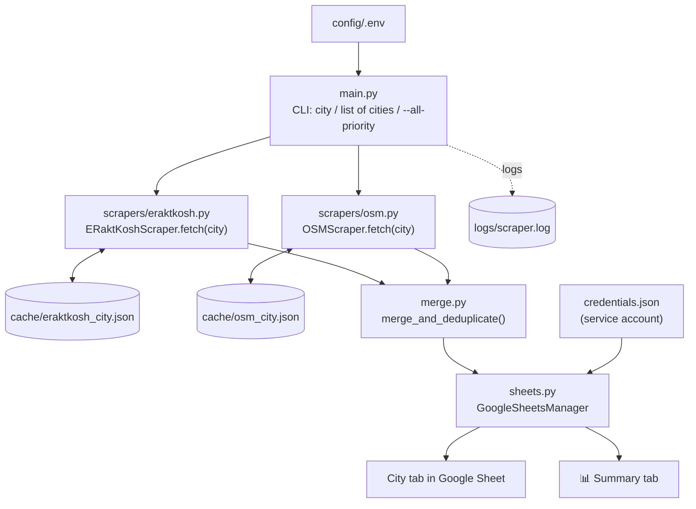

> **📌 This is a Jarurat Care Foundation (JCF) project, not a personal project.** It was built as part of my internship at JCF (Medical Partnerships work) and is shared here to document the work I am doing there.

# Blood Bank Directory Scraper

**Organisation:** Jarurat Care Foundation (JCF) · **Team:** Medical Partnerships · **Type:** Internship task

A Python backend tool that, given a city name, finds the blood banks, blood storage centres and hospital blood banks in that city, cleans and merges the data from two public sources, and writes it into a shared Google Sheet (one tab per city) for JCF's medical partnerships outreach.

> **Context:** This was assigned as an internship task at JCF. It is not a hobby or portfolio project, and the output sheet and its purpose belong to JCF's Medical Partnerships work. This repository exists only to share and document the work.

---

## 1. What it does (in one minute)

You run one command with a city name:

```bash
python main.py "Hyderabad"
```

and the tool will:

1. Pull the city's blood banks from **eRaktKosh** (the Government of India / MoHFW blood bank registry).
2. Pull additional listings from **OpenStreetMap** (Nominatim).
3. **Merge and de-duplicate** the two lists (a facility that appears in both becomes one row).
4. Write the result into a **Google Sheet**, in a tab named after the city, plus a **Summary** tab across all cities processed in that run.

Everything missing is written as `N/A`, never left blank.

---

## 2. How the logic works



### Step by step

**Step 1 – Input (`main.py`)**
The city comes from the command line (one city, a comma-separated list, or `--all-priority` for the 30 priority cities defined in `PRIORITY_CITIES`). If nothing is passed, it asks interactively. For each city, `process_city()` runs the whole pipeline.

**Step 2 – eRaktKosh scraper (`scrapers/eraktkosh.py`)** *(primary source)*
- Maps the city to its **state code** using `STATE_CODE_MAP` (for example Hyderabad → Telangana → `36`). If a city is not in this map, eRaktKosh returns nothing for it.
- Calls the eRaktKosh blood-availability endpoint for that **whole state**, then **filters the facilities to the requested city** by matching the address against the city and its aliases (`CITY_ALIASES`, e.g. Bengaluru = Bangalore). For city-states and UTs such as Delhi and Chandigarh, everything is kept.
- Cleans each record:
  - `clean_phone()` / `is_fake_phone()` keep valid Indian mobiles and landlines and reject placeholder numbers such as `1234567890` or `0000000000`.
  - `parse_contact_blob()` splits the raw contact text into phone and email.
  - `classify_facility()` labels each row as **Blood Bank**, **Hospital Blood Bank** or **Storage Centre**.
  - Website is taken from the email domain when it is an organisation domain (not Gmail, Yahoo, etc.); otherwise it falls back to the eRaktKosh portal URL.

**Step 3 – OpenStreetMap scraper (`scrapers/osm.py`)** *(secondary source)*
- Queries Nominatim for `"blood bank in <city>, India"` (up to 50 results) and converts them to the same record format as eRaktKosh.
- Reuses `clean_phone()` from `eraktkosh.py` so phone cleaning is identical for both sources.

**Step 4 – Merge and de-duplicate (`merge.py`)**
- eRaktKosh records go in first, as the trusted base.
- Each OSM record is compared against the existing records. Names are **normalised** first (lower-cased, and words like "blood bank", "hospital", "trust", "Dr", "Govt" removed), then compared with `rapidfuzz` using `token_set_ratio` with a threshold of **78**.
- **Match found:** the existing record is kept and any missing fields (`website`, `contact_number`, `location`, `state`, `email`) are filled in from OSM, and the source becomes `eRaktKosh / OSM`.
- **No match:** the OSM record is added as a new row.
- Finally, any empty value becomes `N/A` and every row gets the `date_scraped` date.

**Step 5 – Google Sheets (`sheets.py`)**
- Authenticates with a Google **service account** (`credentials.json`) using `gspread`.
- **City tab:** creates a tab named after the city, or clears it if it already exists, then writes all rows in one batch. Re-running a city never creates duplicate rows. The header row is frozen, bold, white on red, and columns are auto-sized.
- **Summary tab (`📊 Summary`):** after all cities in the run finish, writes one row per city with counts of Blood Banks, Hospital Blood Banks, Storage Centres and the total.
- If the sheet or credentials are missing, the tool still runs and just skips the Sheets step.

**Caching:** both scrapers save their raw result to `cache/` (`eraktkosh_<city>.json`, `osm_<city>.json`) and reuse it on the next run, so repeat runs make no network calls. **Delete the city's cache files to force a fresh scrape.**

---

## 3. How the files work together

| File | Role | Talks to |
| :--- | :--- | :--- |
| `main.py` | Entry point. Reads the city input and `.env`, sets up logging, runs the pipeline for each city, and prints a progress summary. | Calls both scrapers, `merge.py` and `sheets.py` |
| `scrapers/eraktkosh.py` | Primary source. State-code lookup, city filtering, phone/email cleaning, facility type classification. | Called by `main.py`; its `clean_phone()` is also imported by `osm.py` |
| `scrapers/osm.py` | Secondary source from OpenStreetMap. | Called by `main.py`; imports `clean_phone` from `eraktkosh.py` |
| `scrapers/__init__.py` | Makes `scrapers` a Python package. | n/a |
| `merge.py` | Fuzzy de-duplication and field enrichment of the two lists. | Receives both scrapers' output from `main.py`, returns one list |
| `sheets.py` | Writes city tabs and the Summary tab to Google Sheets. | Receives merged data from `main.py`; uses `credentials.json` |
| `config/.env` | Local settings: sheet ID, credentials path, request delay, user agent. | Loaded by `main.py` |
| `config/.env.example` | Safe template for `.env`. | Copy it to `.env` |
| `credentials.json` | Google service account key (**secret, never committed**). | Used by `sheets.py` |
| `cache/` | Saved raw results per city and source. | Read and written by both scrapers |
| `logs/scraper.log` | Run log. | Written by `main.py` logging |
| `requirements.txt` | Python dependencies. | `pip install -r requirements.txt` |

**Data flow in one line:** `main.py` → `eraktkosh.py` + `osm.py` → `merge.py` → `sheets.py` → Google Sheet.

---

## 4. Output columns

| Column | Meaning |
| :--- | :--- |
| Name | Facility name |
| Type | `Blood Bank`, `Hospital Blood Bank` or `Storage Centre` |
| Location | Street address |
| City | City the facility belongs to |
| State | State or Union Territory |
| Website | Facility website (email domain) or the eRaktKosh portal |
| Contact Number | Cleaned phone number(s), comma separated |
| Email | Email if available |
| Source | `eRaktKosh`, `OSM` or `eRaktKosh / OSM` |
| Date Scraped | Date of the run (ISO format) |

---

## 5. Setup

**Requirements:** Python 3.9+ and a Google account.

```bash
pip install -r requirements.txt
cp config/.env.example config/.env      # then edit config/.env
```

`config/.env`:

```env
GOOGLE_SPREADSHEET_ID=your_google_spreadsheet_id_here
GOOGLE_SERVICE_ACCOUNT_FILE=credentials.json
REQUEST_DELAY_SECONDS=1.5
MAX_RETRIES=3
USER_AGENT=BloodBankDirectoryScraper/1.0
```

### Google Sheets access (service account)

1. In the [Google Cloud Console](https://console.cloud.google.com/), create a project and enable the **Google Sheets API** and **Google Drive API**.
2. Go to **APIs & Services → Credentials → Create credentials → Service account**, then open it and create a **JSON key** under the **Keys** tab.
3. Save the downloaded key as `credentials.json` in the project root.
4. Open the target Google Sheet, click **Share**, and add the service account's email (found inside `credentials.json`) as **Editor**.
5. Copy the spreadsheet ID from the sheet URL (`.../spreadsheets/d/<THIS_PART>/edit`) into `GOOGLE_SPREADSHEET_ID` in `config/.env`.

> ⚠️ `config/.env` and `credentials.json` contain private keys and IDs belonging to JCF's workspace. They must **never** be pushed to GitHub (see `.gitignore`).

---

## 6. Usage

```bash
python main.py "Delhi"                    # one city
python main.py "Delhi,Mumbai,Hyderabad"   # several cities
python main.py --all-priority             # all 30 priority cities
python main.py                            # interactive prompt
```

**Priority cities (30):** Mumbai, Delhi, Chennai, Bengaluru, Hyderabad, Kolkata, Ahmedabad, Pune, Chandigarh, Thiruvananthapuram, Jaipur, Lucknow, Varanasi, Bhubaneswar, Guwahati, Nagpur, Cuttack, Patna, Coimbatore, Kochi, Indore, Bhopal, Raipur, Ranchi, Amritsar, Shimla, Srinagar, Jabalpur, Visakhapatnam, Dehradun.

To add a new city, add it (and its state) to `STATE_CODE_MAP` in `scrapers/eraktkosh.py`, and optionally to `CITY_ALIASES` for alternate spellings.

---

## 7. Known limitations

- A city must exist in `STATE_CODE_MAP`, otherwise the eRaktKosh part returns no results.
- City filtering relies on the city name appearing in the facility's address, so a few facilities may be missed or mis-assigned.
- OpenStreetMap coverage in India is patchy, so it mainly adds extra listings and fills gaps rather than being a complete source.
- The OSM Overpass fallback is only a quick probe and does not currently add results.
- `MAX_RETRIES` is present in `.env` but retry logic is not implemented yet.
- Data is scraped from public sources and can be outdated, so contact details should be verified before outreach.

---

## 8. About this project

Built by **Datta** as part of an internship at **Jarurat Care Foundation (JCF)** for the Medical Partnerships team. It is **JCF work, not a personal project**, and is published here to share the work I am doing during the internship.
